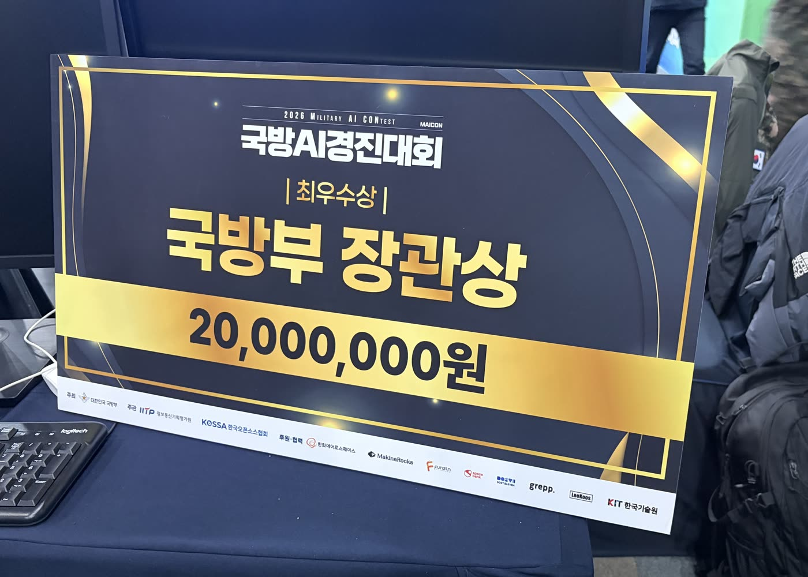
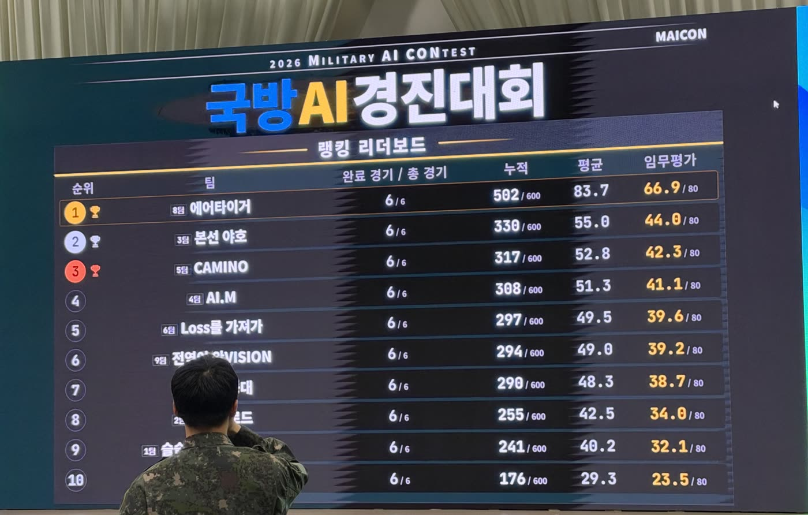
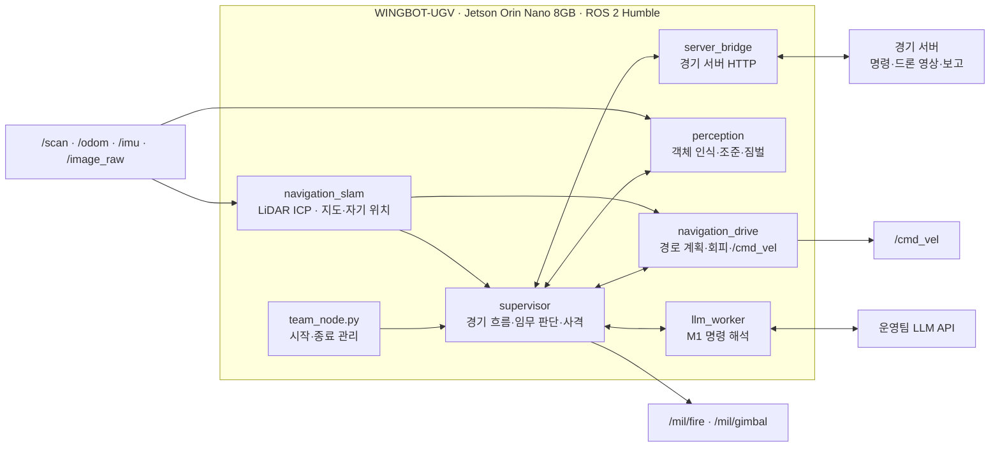

<div align="center">

# 에어타이거 · 2026 국방 AI 경진대회(MAICON) 본선

**자율 UGV로 5분짜리 3:3 연합전을 치르는 ROS 2 팀 프로그램**

본선 10팀 중 **1위 · 최우수상(국방부 장관상)**


</div>

<table>
  <tr>
    <td width="50%"></td>
    <td width="50%"></td>
  </tr>
  <tr>
    <td align="center"><sub>최우수상 · 국방부 장관상 (2026-11-20)</sub></td>
    <td align="center"><sub>본선 최종 리더보드: 누적 502 / 600, 임무평가 66.9 / 80</sub></td>
  </tr>
</table>

- **성격:** 5명 팀 프로젝트. 2026-11-18 ~ 11-20 3일 오프라인 합숙 본선
- **주요 작업:** 경기 흐름·임무 판단(supervisor), 라이다 SLAM과 주행, 드론 화면·카메라 인식과 조준, 경기 서버·LLM 연동
- **기술:** ROS 2 Humble (rclpy), Jetson Orin Nano 8GB, LiDAR ICP 정합, Ultralytics YOLO11 OBB, Anthropic/OpenAI 텍스트 LLM API

## 본선 결과

팀당 6경기(BLUE 3 · RED 3)를 모두 이겼다. 아래는 대회 방송 결과 화면을 옮겨 적은 팀 기록이다.

| 경기 | 진영 · 자리 | M1 명령 해석 | M2 지정표적 | M3 객체 인식 | M4 UGV 타격 | M5 거점 진입 | M6 위험도 | 연합 승리 | 합계 |
|:-:|:-:|:-:|:-:|:-:|:-:|:-:|:-:|:-:|:-:|
| 3 | RED R-2 | 10 | 0 | **30** | 15 | 10 | 5 | 5 | 75 |
| 4 | RED R-3 | 10 | 10 | 21 | 15 | 10 | **15** | 5 | 86 |
| 6 | BLUE B-1 | 10 | 10 | **30** | 15 | 10 | 10 | 5 | 90 |
| 7 | RED R-1 | 10 | **15** | **30** | 15 | 0 | **15** | 5 | 90 |
| 9 | BLUE B-3 | 10 | 10 | 16 | 15 | 10 | **15** | 5 | 81 |
| 10 | BLUE B-2 | 10 | 10 | **30** | 15 | 10 | 0 | 5 | 80 |
| | **배점** | 10 | 15 | 30 | 15 | 10 | 15 | 5 | **누적 502 / 600** |

2위 팀의 누적 점수는 330점이었다. 배점이 가장 큰 M3(전장객체 인식)에서 6경기 중 4경기를 만점으로 받은 것이 점수 차를 가장 크게 벌렸다.

## 프로젝트 개요

대회 측이 지급한 WINGBOT-UGV 한 대가 경기장 안에서 스스로 움직인다. 경기가 시작되면 사람은 개입할 수 없다.
로봇은 `standby` 신호 때 `~/team/team_node.py` 하나만 실행하고, 이 프로그램이 나머지 노드를 띄워 최대 5분 경기와 30초 보고 시간을 처리한다.

| 임무 | 하는 일 | 맡은 노드 |
|---|---|---|
| M1 전술명령 해석 | 자연어 명령에서 지정표적·탐색 섹터·목표거점을 뽑아 보고 | `llm_worker` → `server_bridge` |
| M2 지정표적 타격 | 상대 진영의 지정표적을 찾아 레이저로 맞힘 | `supervisor` · `perception` · `navigation` |
| M3 전장객체 인식 | 섹터별 객체 종류·개수를 인식해 보고 | `perception` → `supervisor` |
| M4 상대 UGV 타격 | 상대 UGV를 찾아 맞히고 우리 피격은 줄임 | `supervisor` · `perception` |
| M5 목표거점 진입 | 4:00에 공개되는 거점에 먼저 들어감 | `navigation` |
| M6 전장 위험도 | 상대 3팀의 위험도 순위를 보고 | `supervisor` → `server_bridge` |

경기 중 연산은 모두 Jetson 안에서 한다. 외부로 나가는 통신은 운영팀이 발급한 LLM API 호출뿐이다.

## 시스템 구성



노드 사이의 토픽·서비스·액션 계약은 [`노드_관리/interfaces.yaml`](노드_관리/interfaces.yaml)에서 관리하고, 메시지 정의 원본은 [`개발/src/team_interfaces/`](개발/src/team_interfaces/)에 있다.

## 구현 내용

| 노드 | 구현 방식 |
|---|---|
| [`supervisor`](개발/src/supervisor/) | 서버 단계(`ready` → `running` → `reporting`)에 맞춰 임무 순서를 정하고, 정찰·지정표적 사격·거점 대기·M6 관측을 차례로 지시하고, 관측한 상대 상태로 M6 순위를 직접 정한다. 거점 안에 다른 로봇이 서 있으면 먼 쪽으로 비켜 선 뒤 돌진한다 |
| [`navigation`](개발/src/navigation/) | `navigation_slam`은 드론 지도의 상자·외벽에 LiDAR 스캔을 ICP로 맞춰 위치를 추정하고, 라이다로 드론 지도를 보정한다. 밀려서 방향을 잃으면 마지막으로 정합한 자리 주변을 전 방향으로 다시 찾는다. `navigation_drive`는 격자 경로 계획·장애물 회피와 `/cmd_vel` 단독 발행을 맡는다 |
| [`perception`](개발/src/perception/) | 경기 서버의 드론 화면에서 YOLO OBB로 상자와 UGV를 찾아 지도 좌표로 바꾼다(612×500 px, 1 cm/px). 팬틸트 카메라 사진으로 상자 옆면 객체를 판독하고 조준을 돕는다. 조명 변형으로 학습 데이터를 늘리고 조명 조건별로 따로 평가했다 |
| [`server_bridge`](개발/src/server_bridge/) | 준비완료·임무 수신(롱폴링)·드론 영상·보고 HTTP를 ROS로 바꾼다. 상태 코드·타임아웃·재시도를 모두 확인하고, 보고 접수와 채점 성공을 구분한다 |
| [`llm_worker`](개발/src/llm_worker/) | 낱말 규칙으로 명령문을 먼저 풀고, LLM 답이 제한 시간 안에 오면 검증된 항목만 덮어쓴다. LLM이 늦거나 실패해도 M1 보고가 나간다 |
| [`개발/robot`](개발/robot/) | `team_node.py`가 `programs.json`에 적힌 프로그램을 자식으로 띄우고, `stop` 뒤 1.5초 안에 함께 끝낸다. 실행할 때마다 코드 지문(`version.json`)과 함께 기록 폴더를 남긴다 |

## 검증 현황

| 구분 | 내용 | 기록 |
|---|---|---|
| 실차 | UGV 정지·직진 센서 bag, `cmd_vel` 개방루프 주행 (2026-11-18) | [`navigation/시험기록`](개발/src/navigation/시험기록/) |
| 실경기장 기록 재생 | 본선 경기장 기록의 스캔을 실제 노드 코드에 다시 넣어 위치 재탐색 검증 (2026-11-19 ~ 20) | 같은 폴더의 `2026-11-19_*`, `2026-11-20_*` |
| 팀 테스트 | 경기장 1, R2 자리에서 세 번 실행한 전체 로그 (2026-11-18) | [`로그_파일/`](로그_파일/) |
| 컨테이너 | 가짜 경기 서버·가짜 상대와 한 경기 흐름 시험, Spark에서 ROS 2 빌드 스모크 (2026-11-15) | [`임시_테스트_파일/`](임시_테스트_파일/) · [`result/`](result/) |

본선 경기의 영상과 경기별 로봇 로그 전체는 이 저장소에 없다. 위 점수는 대회 공식 결과 화면 기준이다.

## 시작하기

실행하려면 대회 지급 UGV(ROS 2 Humble 컨테이너)와 대회 측 `mil_msgs`가 필요하다. 자세한 절차는 [`개발/robot/README.md`](개발/robot/README.md)에 있다.

```bash
# 1) 저장소가 있는 PC에서 묶음 만들기 (어느 커밋인지 VERSION 파일로 같이 들어간다)
bash 개발/robot/make_bundle.sh

# 2) team_bundle.tgz를 로봇으로 옮긴 뒤, 로봇 컨테이너 안에서
mkdir -p ~/team && tar xzf team_bundle.tgz -C ~/team
cp ~/team/secrets.example.json ~/team/secrets.json   # 서버 주소·임무코드·LLM 키를 직접 채운다
cd ~/team/ws && colcon build
```

- `secrets.json`은 저장소에 올리지 않는다. 임무코드와 키는 로그에 찍지 않는다
- 경기 신호 없이 흐름만 보려면 `~/team/supervisor.json`에 `{"force_start": true, "slot": "B-1"}`을 둔다
- 노드 구성 화면: 저장소 루트에서 `python3 -m http.server 8767 --bind 127.0.0.1` 실행 후 `http://127.0.0.1:8767/노드_관리/architecture.html`을 연다

## 저장소 구성

```
개발/robot/          로봇 ~/team/ 에 올리는 시작 파일 (team_node.py · programs.json · lidar.sh)
개발/src/            ROS 2 패키지 — supervisor · navigation · perception · server_bridge · llm_worker · team_interfaces
노드_관리/           노드·토픽·서비스 계약(interfaces.yaml)과 구성 화면(architecture.html)
로그_파일/           실차·팀 테스트 실행 기록과 요약 도구
임시_테스트_파일/     가짜 경기 서버·가짜 상대, 실험 스크립트
result/             팀 공유 문서와 빌드 검증 결과
작업_규칙.md          대회 기간 팀이 쓴 저장소 작업 규칙 (원문 그대로)
```

## 팀

5명 팀. 아래 영역은 커밋 기록 기준이며, 판단과 통합은 현장 회의로 함께 정했다.

| GitHub | 주로 맡은 영역 |
|---|---|
| [@shnoh-cs](https://github.com/shnoh-cs) | 팀장 · supervisor 전체 흐름과 통합 |
| [@sesepark](https://github.com/sesepark) | navigation · LiDAR SLAM, 노드 구조와 작업 규칙 설계 |
| [@ANseunghyeon](https://github.com/ANseunghyeon) | supervisor 사격·M6, perception |
| [@pypypypy5](https://github.com/pypypypy5) | perception 드론 화면 인식·학습 |
| [@woojintemp](https://github.com/woojintemp) | 사전 준비용 2D 경기 시뮬레이터, perception |

## 사용 범위와 한계

- 대회 측이 배포한 사전교육 자료·API 문서·공식 뼈대·Q&A는 **외부 공유가 금지된 자료라 이 공개본에서 뺐다.** 코드와 문서에 남은 `공식_자료/…` 경로는 원래 비공개 저장소의 위치다
- 이 공개본은 본선 마지막 날(2026-11-20) 팀 저장소 `main`의 스냅숏이다. 이전 커밋 이력과 작업 브랜치는 포함하지 않는다
- 경기장·로봇 사양 값 일부는 현장 실측 전 추정치다. 각 패키지 README에 「확인 필요」로 표시돼 있다
- `perception/training/drone_boxes/trained/`의 가중치는 Ultralytics YOLO11 사전학습 모델에서 학습했다. Ultralytics는 AGPL-3.0이다
- 대회 지급 UGV와 경기 서버 없이 전체를 그대로 실행할 수는 없다
