<div align="center">

# 에어타이거 · 2026 국방 AI 경진대회(MAICON) 본선

**자율 UGV로 5분짜리 3:3 연합전을 치르는 ROS 2 팀 프로그램**


[](https://www.segye.com/newsView/20261120514567)
[](https://www.segye.com/newsView/20261120514567)
[](https://maicon.kr/)

<br>

<table>
<tr>
<td align="center"><b>🏆 종합 1위</b><br><sub>최우수상 · 국방부 장관상</sub></td>
<td align="center"><b>6전 6승</b><br><sub>팀당 6경기 전승</sub></td>
<td align="center"><b>502 / 600</b><br><sub>2위 팀 330점</sub></td>
<td align="center"><b>M3 만점 4회</b><br><sub>6경기 중</sub></td>
</tr>
</table>


&nbsp;


<sub>최우수상 · 국방부 장관상 + 상금 2,000만 원 (2026-11-20 시상식, 화성 YBM 연수원) &nbsp;|&nbsp; 본선 최종 리더보드: 누적 502 / 600, 임무평가 66.9 / 80</sub>

</div>

- **성격:** 5명 팀 프로젝트. 2026-11-18 ~ 11-20 3일 오프라인 합숙 본선
- **주요 작업:** 경기 흐름·임무 판단(supervisor), 라이다 SLAM과 주행, 드론 화면·카메라 인식과 조준, 경기 서버·LLM 연동
- **기술:** ROS 2 Humble (rclpy), Jetson Orin Nano 8GB, LiDAR ICP 정합, Ultralytics YOLO11 OBB, Anthropic/OpenAI 텍스트 LLM API

## 언론 보도

> **국방부**가 주최하고 **정보통신기획평가원(IITP)·한국오픈소스협회**가 주관한 **제5회 국방 AI 경진대회(MAICON)** 본선이 2026년 11월 18~20일 경기 화성 YBM 연수원에서 열렸다. 올해 과제는 피지컬 AI와 유·무인 복합전투체계(MUM-T)를 접목한 **무인지상차량(UGV)의 도심 전술작전**으로, 자연어 전술명령 해석·지정표적 모의타격·전장객체 실시간 탐지·상대 UGV 교전·목표거점 진입·전장 위험도 분석 6개 종목으로 짜였다. 1,400여 명이 지원해 온라인 코딩테스트를 통과한 50명(군 장병 40·일반인 10)이 군 4인·일반 1인으로 짜인 10개 혼합팀으로 맞붙었다.
>
> 그 결과 **최우수상(국방부 장관상)과 상금 2,000만 원은 에어타이거 팀**에 돌아갔다. 보도는 에어타이거가 *"전장객체 인식과 상대 UGV 타격, 전장 위험도 분석 등 대부분의 임무에서 최고점을 기록했다"* 고 전했다 — 이 저장소의 [본선 성적](#본선-성적) 기록과 일치한다.

<p align="center">
  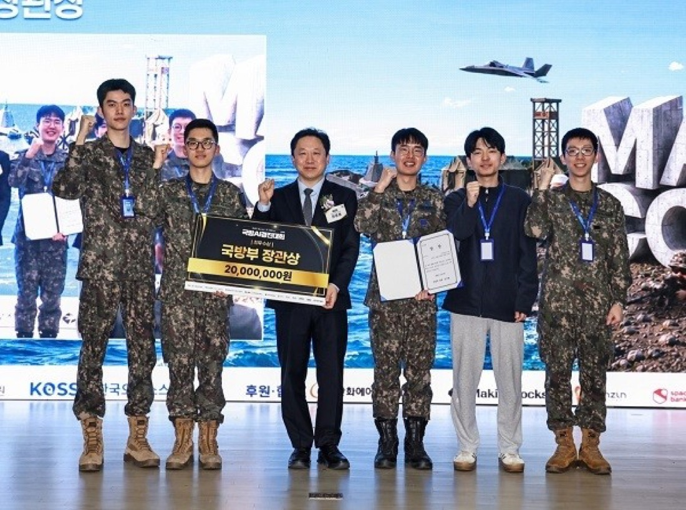
</p>

<p align="center"><sub>🎖️ 2026-11-20 시상식 · 에어타이거 팀이 <b>국방부 장관상(상금 2,000만 원)</b>을 받고 단체 기념 촬영</sub></p>

<p align="center">
  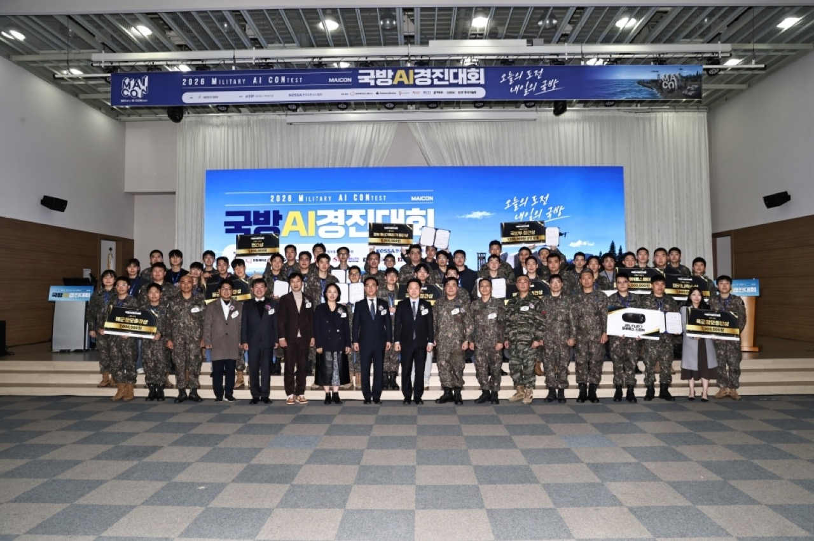
</p>

<p align="center"><sub>본선 50명 전원과 시상자 단체 기념 촬영 · 화성 YBM 연수원 (사진 사용 권리: 팀 보유)</sub></p>

<p align="center">
  <a href="https://youtu.be/lL7f1nS82jQ"></a>
</p>

<p align="center"><sub>📺 <b>방송 보도</b> · KFN 국방뉴스(국방홍보원) 「"조종자가 없다"…국방 AI 경진대회서 무인차량 격돌」 → <a href="https://youtu.be/lL7f1nS82jQ">영상 보기</a></sub></p>

<sub>출처: [세계일보](https://www.segye.com/newsView/20261120514567)(2026-11-20, 박수찬 기자) · [이뉴스투데이](http://www.enewstoday.co.kr/news/articleView.html?idxno=2495755)(2026-11-23, "대부분의 임무에서 최고점" 보도) · [파이낸셜뉴스](https://www.fnnews.com/news/202611231512458722)(2026-11-23) · [신아일보](https://www.shinailbo.co.kr/news/articleView.html?idxno=5086077) · [대회 공식 maicon.kr](https://maicon.kr/) &nbsp;|&nbsp; 신청자 수는 매체에 따라 1,314~1,413명으로 보도됨</sub>

## 본선 성적

<p align="center">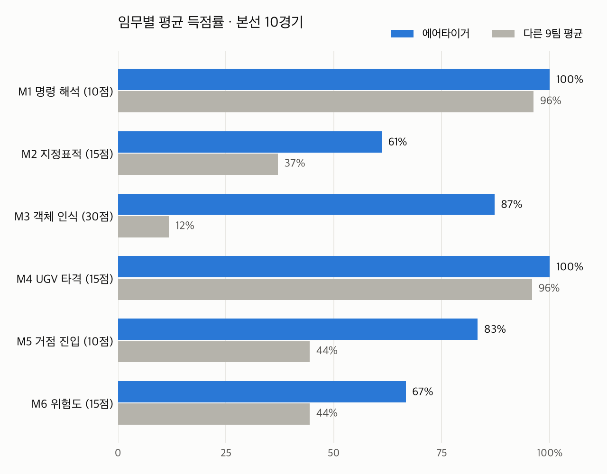</p>

<sub>본선 10경기 방송 결과 화면을 옮겨 적은 팀 기록으로 계산했다. 팀마다 출전한 경기의 임무별 평균을 배점으로 나눴고, 회색 막대는 나머지 9팀 평균의 평균이다. 배점이 가장 큰 <b>M3 객체 인식에서 우리 87% · 다른 팀 12%</b>로 점수 차를 가장 크게 벌렸다.</sub>

<details>
<summary>경기별 점수 표 (6경기 전승)</summary>

| 경기 | 진영 · 자리 | M1 명령 해석 | M2 지정표적 | M3 객체 인식 | M4 UGV 타격 | M5 거점 진입 | M6 위험도 | 연합 승리 | 합계 |
|:-:|:-:|:-:|:-:|:-:|:-:|:-:|:-:|:-:|:-:|
| 3 | RED R-2 | 10 | 0 | **30** | 15 | 10 | 5 | 5 | 75 |
| 4 | RED R-3 | 10 | 10 | 21 | 15 | 10 | **15** | 5 | 86 |
| 6 | BLUE B-1 | 10 | 10 | **30** | 15 | 10 | 10 | 5 | 90 |
| 7 | RED R-1 | 10 | **15** | **30** | 15 | 0 | **15** | 5 | 90 |
| 9 | BLUE B-3 | 10 | 10 | 16 | 15 | 10 | **15** | 5 | 81 |
| 10 | BLUE B-2 | 10 | 10 | **30** | 15 | 10 | 0 | 5 | 80 |
| | **배점** | 10 | 15 | 30 | 15 | 10 | 15 | 5 | **누적 502 / 600** |

</details>

### 현장에서 올린 완성도

<p align="center">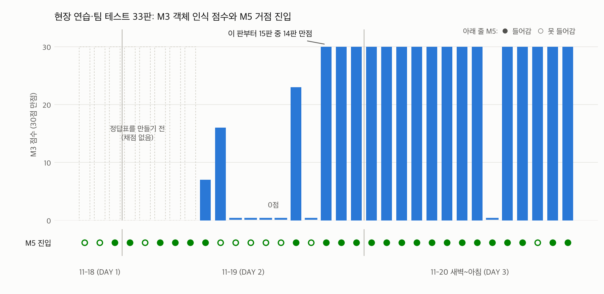</p>

<sub>본선 3일 동안 돌린 연습·팀 테스트 33판의 기록이다. 자료는 팀 경기 기록 도구에서 받았다. 둘째 날 저녁(11-19 21:53) 무렵 인식이 자리를 잡은 뒤로는 <b>15판 중 14판이 M3 만점</b>이었고, M5 거점 진입도 거의 매 판 성공했다. 점수는 경기 뒤 팀이 만든 정답표와 맞춘 값이며, 공식 채점이 아니다.</sub>

## 무엇을 하는가

<p align="center">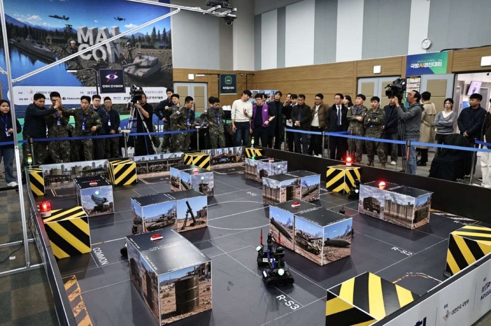</p>

<sub><b>본선 경기장</b> · 전장객체 사진을 붙인 큐브 표적과 노란·검정 장애물이 섹터(R-S2·R-S3·COMMON) 위에 놓이고, 가운데 WINGBOT-UGV가 사람 개입 없이 스스로 임무를 수행한다. 상자 배치는 경기마다 바뀐다. (사진 사용 권리: 팀 보유)</sub>

대회 측이 지급한 WINGBOT-UGV 한 대가 경기장 안에서 스스로 움직인다. 경기가 시작되면 사람은 개입할 수 없다.
로봇은 `standby` 신호 때 `~/team/team_node.py` 하나만 실행하고, 이 프로그램이 나머지 노드를 띄워 최대 5분 경기와 30초 보고 시간을 처리한다. 경기 중 연산은 모두 Jetson 안에서 하고, 외부로 나가는 통신은 운영팀이 발급한 LLM API 호출뿐이다.

| 임무 | 하는 일 | 맡은 노드 |
|---|---|---|
| **M1** 전술명령 해석 | 자연어 명령에서 지정표적·탐색 섹터·목표거점을 뽑아 보고 | `llm_worker` → `server_bridge` |
| **M2** 지정표적 타격 | 상대 진영의 지정표적을 찾아 레이저로 맞힘 | `supervisor` · `perception` · `navigation` |
| **M3** 전장객체 인식 | 섹터별 객체 종류·개수를 인식해 보고 | `perception` → `supervisor` |
| **M4** 상대 UGV 타격 | 상대 UGV를 찾아 맞히고 우리 피격은 줄임 | `supervisor` · `perception` |
| **M5** 목표거점 진입 | 4:00에 공개되는 거점에 먼저 들어감 | `navigation` |
| **M6** 전장 위험도 | 상대 3팀의 위험도 순위를 보고 | `supervisor` → `server_bridge` |

### 한 판은 이렇게 흘러간다

<table>
  <tr>
    <td width="42%">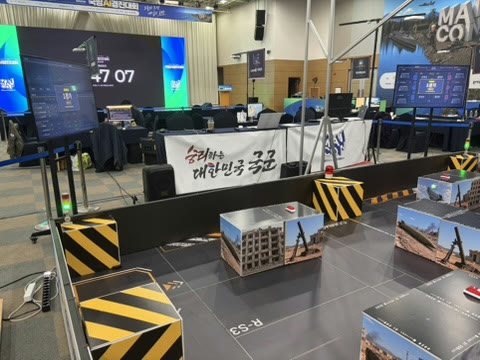</td>
    <td width="58%">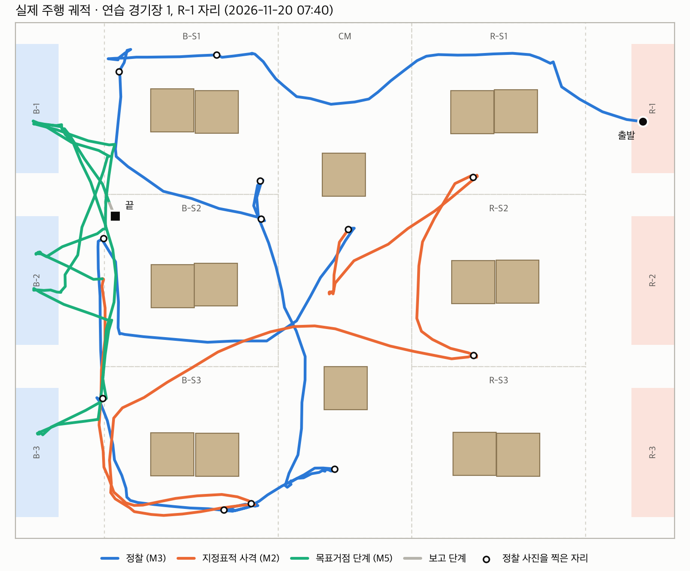</td>
  </tr>
  <tr>
    <td><sub><b>실제 본선 경기장</b> · 바닥에 섹터(R-S3…)가 그려져 있고, 군용 장비 그림이 붙은 표적 상자와 장애물이 놓인다. 상자 배치는 경기마다 바뀐다.</sub></td>
    <td><sub><b>실제 주행 궤적</b> · 2026-11-20 아침 연습 경기장, R-1 자리 한 판(연습 경기). 로봇이 남긴 위치 기록(약 0.5초 간격)을 단계별로 색을 나눴다. <b>정찰(파랑)</b>로 섹터를 돌며 상자 면을 찍어 객체를 보고하고, <b>지정표적 사격(주황)</b> 뒤 거점이 공개되면 <b>목표거점(초록)</b>으로 돌진한다. 흰 점은 정찰 사진을 찍은 자리다.</sub></td>
  </tr>
</table>

## 시스템 구성

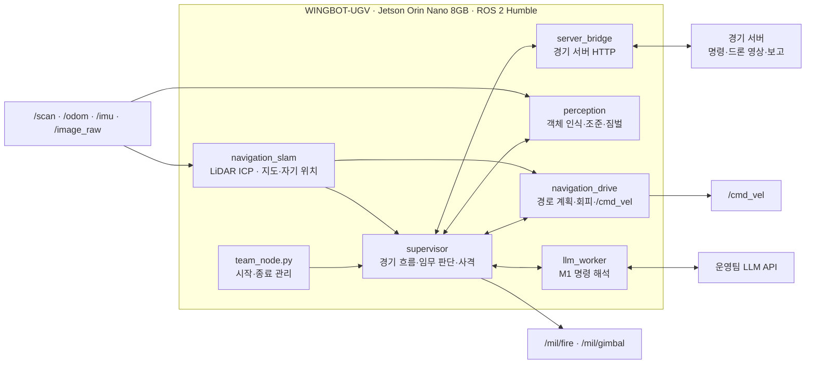

팀 노드 6개가 메시지로만 주고받는다. 토픽·서비스·액션 계약은 팀이 만든 구성 화면으로 관리했다.

<p align="center">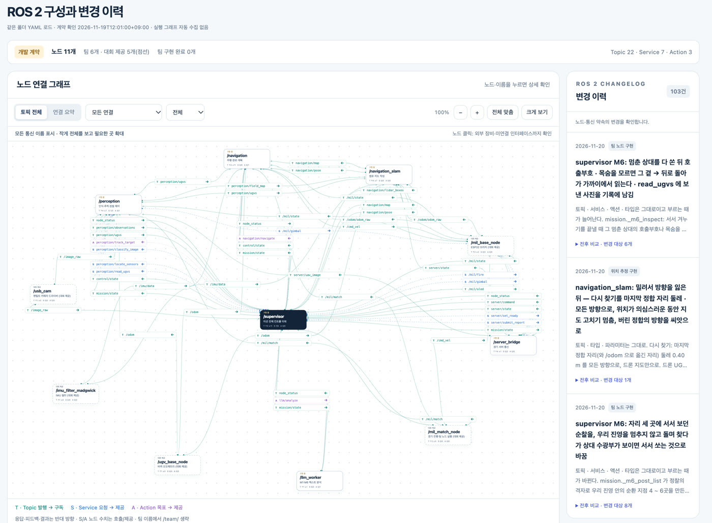</p>

<sub>팀이 만든 ROS 2 구성 화면(<code>노드_관리/architecture.html</code>, 저장소에 포함). 팀 노드 6개와 대회 제공 노드 5개, 토픽 22 · 서비스 7 · 액션 3의 연결과 계약 변경 이력 103건을 보여 준다. 계약 원본은 <a href="노드_관리/interfaces.yaml"><code>노드_관리/interfaces.yaml</code></a>, 메시지 정의는 <a href="개발/src/team_interfaces/"><code>개발/src/team_interfaces/</code></a>에 있다.</sub>

## 구현 내용

| 노드 | 구현 방식 |
|---|---|
| [`supervisor`](개발/src/supervisor/) | 서버 단계(`ready` → `running` → `reporting`)에 맞춰 임무 순서를 정하고, 정찰·지정표적 사격·거점 대기·M6 관측을 차례로 지시하고, 관측한 상대 상태로 M6 순위를 직접 정한다. 거점 안에 다른 로봇이 서 있으면 먼 쪽으로 비켜 선 뒤 돌진한다 |
| [`navigation`](개발/src/navigation/) | `navigation_slam`은 드론 지도의 상자·외벽에 LiDAR 스캔을 ICP로 맞춰 위치를 추정하고, 라이다로 드론 지도를 보정한다. 밀려서 방향을 잃으면 마지막으로 정합한 자리 주변을 전 방향으로 다시 찾는다. `navigation_drive`는 격자 경로 계획·장애물 회피와 `/cmd_vel` 단독 발행을 맡는다 |
| [`perception`](개발/src/perception/) | 경기 서버의 드론 화면에서 YOLO OBB로 상자와 UGV를 찾아 지도 좌표로 바꾼다(612×500 px, 1 cm/px). 팬틸트 카메라 사진으로 상자 옆면 객체를 판독하고 조준을 돕는다. 조명 변형으로 학습 데이터를 늘리고 조명 조건별로 따로 평가했다 |
| [`server_bridge`](개발/src/server_bridge/) | 준비완료·임무 수신(롱폴링)·드론 영상·보고 HTTP를 ROS로 바꾼다. 상태 코드·타임아웃·재시도를 모두 확인하고, 보고 접수와 채점 성공을 구분한다 |
| [`llm_worker`](개발/src/llm_worker/) | 낱말 규칙으로 명령문을 먼저 풀고, LLM 답이 제한 시간 안에 오면 검증된 항목만 덮어쓴다. LLM이 늦거나 실패해도 M1 보고가 나간다 |
| [`개발/robot`](개발/robot/) | `team_node.py`가 `programs.json`에 적힌 프로그램을 자식으로 띄우고, `stop` 뒤 1.5초 안에 함께 끝낸다. 실행할 때마다 코드 지문(`version.json`)과 함께 기록 폴더를 남긴다 |

## 실물·시뮬레이션 검증

<table>
  <tr>
    <td width="50%">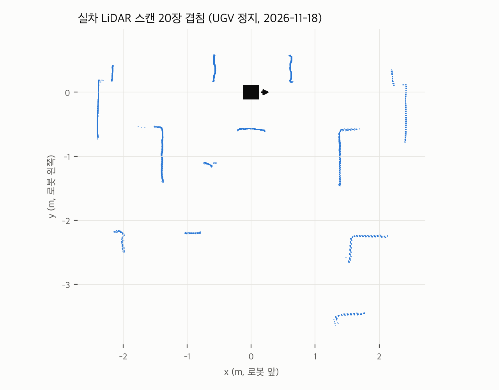</td>
    <td width="50%">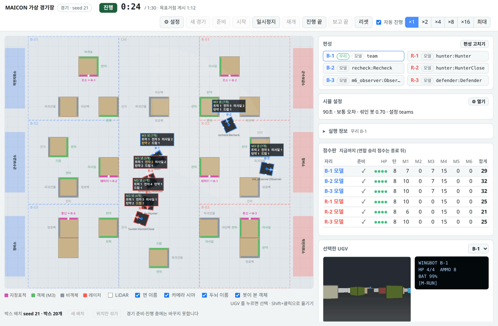</td>
  </tr>
  <tr>
    <td><sub><b>실차 LiDAR</b> · UGV-08이 멈춘 상태에서 받은 <code>/scan</code> 20장을 로봇 기준 좌표로 겹쳤다. 주변 상자 면과 벽이 선으로 찍힌다. 원본은 <code>시험기록/2026-11-18_실차_주행/lidar_stationary</code>의 bag이다</sub></td>
    <td><sub><b>가상 경기장</b> · 본선 전 경기 규칙·서버 API·주행 전략을 미리 시험하려고 만든 2D 시뮬레이터. 6대의 UGV를 봇이나 팀 코드가 몰고, 점수와 규정 위반을 같이 계산한다. 시뮬레이터 코드는 사전 준비 저장소(비공개)에 있다</sub></td>
  </tr>
</table>

| 구분 | 내용 | 기록 |
|---|---|---|
| 실차 | UGV 정지·직진 센서 bag, `cmd_vel` 개방루프 주행 (2026-11-18) | [`navigation/시험기록`](개발/src/navigation/시험기록/) |
| 실경기장 기록 재생 | 본선 경기장 기록의 스캔을 실제 노드 코드에 다시 넣어 위치 재탐색 검증 (2026-11-19 ~ 20) | 같은 폴더의 `2026-11-19_*`, `2026-11-20_*` |
| 팀 테스트 | 경기장 1, R2 자리에서 세 번 실행한 전체 로그 (2026-11-18) | [`로그_파일/`](로그_파일/) |
| 컨테이너 | 가짜 경기 서버·가짜 상대와 한 경기 흐름 시험, Spark에서 ROS 2 빌드 스모크 (2026-11-15) | [`임시_테스트_파일/`](임시_테스트_파일/) · [`result/`](result/) |

## 저장소 구성

```
개발/robot/          로봇 ~/team/ 에 올리는 시작 파일 (team_node.py · programs.json · lidar.sh)
개발/src/            ROS 2 패키지 — supervisor · navigation · perception · server_bridge · llm_worker · team_interfaces
노드_관리/           노드·토픽·서비스 계약(interfaces.yaml)과 구성 화면(architecture.html)
로그_파일/           실차·팀 테스트 실행 기록과 요약 도구
임시_테스트_파일/     가짜 경기 서버·가짜 상대, 실험 스크립트
result/             팀 공유 문서와 빌드 검증 결과
작업_규칙.md          대회 기간 팀이 쓴 저장소 작업 규칙 (원문 그대로)
```

로봇에 올리고 빌드하는 절차는 [`개발/robot/README.md`](개발/robot/README.md)에, 구성 화면 여는 법은 [`노드_관리/README.md`](노드_관리/README.md)에 있다.

## 팀

5명 팀. 아래 영역은 커밋 기록 기준이며, 판단과 통합은 현장 회의로 함께 정했다.

| GitHub | 주로 맡은 영역 |
|---|---|
| [@shnoh-cs](https://github.com/shnoh-cs) | 팀장 · supervisor 전체 흐름과 통합 |
| [@sesepark](https://github.com/sesepark) | navigation · LiDAR SLAM, 노드 구조와 작업 규칙 설계 |
| [@ANseunghyeon](https://github.com/ANseunghyeon) | supervisor 사격·M6, perception |
| [@pypypypy5](https://github.com/pypypypy5) | perception 드론 화면 인식·학습 |
| [@woojintemp](https://github.com/woojintemp) | 사전 준비용 2D 경기 시뮬레이터, perception |

## 사용 범위와 한계

- 대회 측이 배포한 사전교육 자료·API 문서·공식 뼈대·Q&A는 **외부 공유가 금지된 자료라 이 공개본에서 뺐다.** 코드와 문서에 남은 `공식_자료/…` 경로는 원래 비공개 저장소의 위치다
- 이 공개본은 본선 마지막 날(2026-11-20) 팀 저장소 `main`의 스냅숏이다. 이전 커밋 이력과 작업 브랜치는 포함하지 않는다
- `노드_관리/interfaces.yaml`의 변경 이력 26건에 빠져 있던 빈 `service_ids` · `action_ids` 배열을 공개본에서 채웠다. 이 배열이 없으면 구성 화면이 열리지 않는다. 내용은 바꾸지 않았다
- 인식 모델의 학습 그래프와 예측 예시는 학습 서버에만 있어 이 저장소에 없다
- 경기장·로봇 사양 값 일부는 현장 실측 전 추정치다. 각 패키지 README에 「확인 필요」로 표시돼 있다
- `perception/training/drone_boxes/trained/`의 가중치는 Ultralytics YOLO11 사전학습 모델에서 학습했다. Ultralytics는 AGPL-3.0이다
- 대회 지급 UGV와 경기 서버 없이 전체를 그대로 실행할 수는 없다
